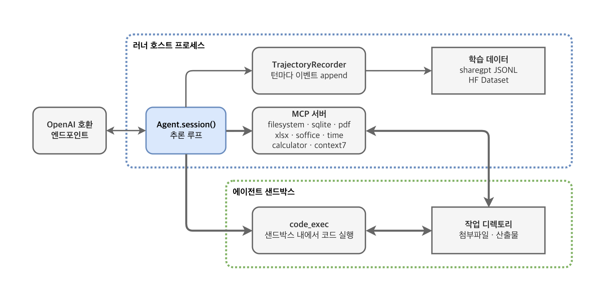
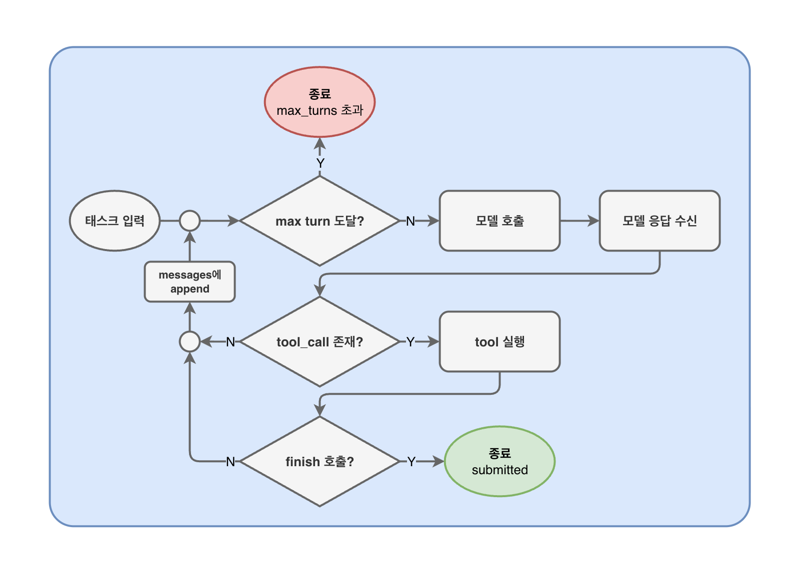

# AgentTracer

Run agentic tasks against any OpenAI-compatible LLM endpoint (vLLM first) and
record structured trajectories, exportable as SFT/RL training datasets.

Built on [Stirrup](https://github.com/ArtificialAnalysis/Stirrup) (agent loop,
code-exec sandbox, MCP client) — see `NOTICE` for attribution.

## Overview

`agent-tracer` is a Python framework for collecting agent execution traces
for model training and evaluation. It connects an OpenAI-compatible model
endpoint to task datasets, tools, and execution environments, then records
the model's reasoning, responses, and tool calls as structured events.

- Run tasks with Docker isolation and configurable MCP tools.
- Configure models, datasets, and runs through YAML and CLI overrides.
- Resume interrupted runs by skipping completed samples.
- Export trajectories as ShareGPT, Hugging Face, or GRPO datasets for
  supervised fine-tuning (SFT) and reinforcement learning (RL).

## How it works



A task gets its own sandbox, and two things reach into it. `code_exec` runs
inside it. The sandbox-bound MCP servers — `filesystem`, `sqlite`, `pdf`,
`xlsx`, `soffice` — are separate processes on the host that `attach()` in for
the seconds a call takes, rather than living inside and holding a session open
for the life of the agent. Which sandbox is this task's reaches them as
`AGENT_TRACER_*` environment variables: a manifest is read once at startup and
cannot name a sandbox that does not exist yet.



One model turn emits a sequence of blocks — reasoning, text, tool calls — and
the recorder writes each of them as a trajectory event. A turn that calls no
tool does not end the run: the loop appends the message and asks the model to
continue. It ends on a `submit` that succeeded, or when `max_turns` runs out and
the trajectory is closed with `exit_status: max_turns`.

Both diagrams are pages of `resource/agent-tracer.drawio`, which the PNGs
beside it are exported from.

The trajectory file format the recorder writes — envelope, the twelve event
types and their payloads, and how the exporters read them — is specified in
[docs/trajectory-schema.md](docs/trajectory-schema.md). What the framework is
required to do, as verifiable requirements mapped to the modules that satisfy
them, is [docs/requirements.md](docs/requirements.md).

## Quick start

```bash
uv sync
cp .env.sample .env      # then fill in the keys it lists
uv run agent-tracer run -f config/example.yaml
uv run agent-tracer export -F sharegpt   # or: -F hf | -F grpo
```

- Config: YAML + `-c key.path=value` overrides. `api_key` accepts `env:VAR`
  references or literals; `reasoning_key` is required per model (fail-fast).
- MCP servers: drop a folder with an `mcp.json` manifest under
  `src/agent_tracer/mcp_servers/` — auto-discovered, default all, narrowed via
  `mcp.include`/`mcp.exclude`. See `src/agent_tracer/mcp_servers/README.md`.
- Sandbox: `environment.type: docker` runs code in an isolated container
  (no network, memory/pids caps).
- Web tools: `tools.web: true` adds stirrup's `web_fetch` and `web_search`.
  `web_search` needs a Brave Search key — `tools.brave_api_key` or
  `BRAVE_API_KEY`. Without one the run refuses to start, because upstream
  would otherwise drop `web_search` and hand the agent `web_fetch` alone.

## After an interrupted run

Containers are torn down, and images a task brought are released, when a run
ends normally. A run that is killed does neither, so both are left behind —
after a set whose tasks ship their own images, that is easily 100 GB.

```bash
docker ps -aq --filter status=exited | xargs -r docker rm
docker images --format '{{.Repository}}:{{.Tag}}' | grep '^swerebenchv2/' | xargs -r docker rmi
```

Filter rather than pruning: `docker system prune -a` also removes the sandbox
base image and anything else on the host that is not currently running.

Re-running the same command resumes — finished samples are skipped — so
cleaning up first costs nothing.

## Development

```bash
uv run pytest tests/
```

## Contributing

See the [contributing guide](CONTRIBUTING.md) for setup, issue reporting, the
pull request workflow, and required checks. All participants are expected to
follow the [Code of Conduct](CODE_OF_CONDUCT.md).

Use the [issue templates](https://github.com/MotifTechnologies/AgentTracer/issues/new/choose)
to report a bug or request a feature. For vulnerabilities, follow the private
reporting instructions in the [security policy](SECURITY.md).

## License

The Security workflow generates a [CycloneDX SBOM and license policy report](docs/sbom.md)
for the Python runtime, development dependencies and packaged stdio MCP servers.
The guide explains how to download the reports, reproduce the checks and maintain
dependency locks. License policy acceptance still requires preserving the notices
that apply when distributing dependencies.

Apache License 2.0 — see `LICENSE`.

`src/agent_tracer/models/client.py` adapts code from
[Stirrup](https://github.com/ArtificialAnalysis/Stirrup) and remains under the
MIT License; `NOTICE` carries that attribution.

### Plain-answer SFT augmentation

To mix original `submit` endings with ordinary assistant answers without model
calls, see [the offline SFT v2 builder](docs/sft-v2.md).
